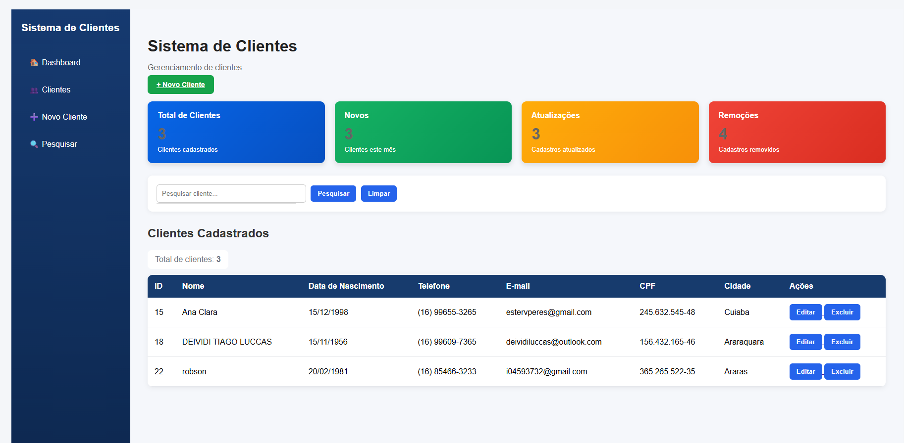
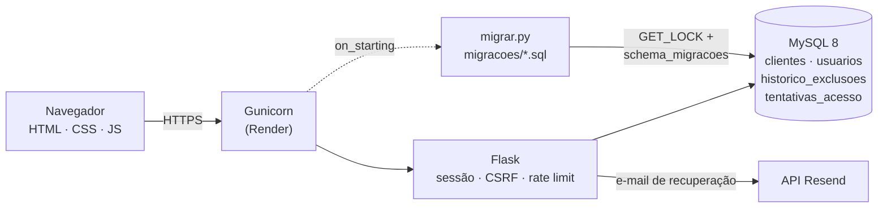

<div align="center">

# Sistema de Clientes

**Cadastro de clientes com Flask e MySQL, pensado para continuar correto com vários usuários e requisições ao mesmo tempo.**

[](https://github.com/DeividiLuccasdev/sistema-clientes-flask/actions/workflows/ci.yml)


[**Demo ao vivo**](https://sistema-clientes-flask-ev90.onrender.com) · [Correções de bugs e segurança](CORRECOES.md) · [Portfólio](https://portfolio-deividi.vercel.app/)

**Acesso de demonstração** · usuário: `demo` (e-mail `demo@example.com`) · senha: `Demo@2026`



</div>

> A demo roda no plano gratuito do Render, que "adormece" o servidor após 15 minutos sem uso. **O primeiro acesso pode demorar de 30 a 60 segundos**; depois que ele acorda, tudo responde normalmente.

## Sobre

Sistema web para gerenciar clientes: cadastrar, pesquisar, editar e excluir registros, com login, recuperação de senha por e-mail e um dashboard de indicadores. Começou como projeto de estudos de desenvolvimento web com Python, Flask e MySQL.

A parte difícil não é o CRUD, e sim o que acontece quando duas requisições chegam juntas: dois cadastros com o mesmo CPF, duas pessoas editando o mesmo cliente, clique duplo na exclusão, tentativas de login em paralelo para furar o limite. Cada um desses casos é resolvido no banco e coberto por testes com requisições simultâneas.

## Funcionalidades

| | |
| --- | --- |
| **Clientes** | Cadastro, edição e exclusão com confirmação; máscaras para CPF, telefone e data de nascimento; registro da data de cadastro e das atualizações. |
| **Pesquisa** | Busca por nome, telefone, e-mail, CPF ou cidade, com sugestões de nomes durante a digitação. |
| **CPF único** | Garantido pelo banco, com ou sem máscara, inclusive em cadastros simultâneos. |
| **Edição concorrente** | Trava otimista: quem salva com dados desatualizados recebe aviso, com os dados atuais, em vez de sobrescrever. |
| **Histórico** | Toda exclusão fica registrada na tabela `historico_exclusoes`. |
| **Dashboard** | Total de clientes, novos clientes, clientes atualizados e clientes removidos. |
| **Usuários** | Login, cadastro de usuários (para quem já está logado), comando `criar-usuario` para o primeiro acesso e recuperação de senha por e-mail via [Resend](https://resend.com). |

## Arquitetura



Uma aplicação Flask em um único arquivo (`app.py`), com uma conexão MySQL por requisição, fechada ao final dela. As páginas são templates Jinja2 renderizados no servidor; o JavaScript cuida só de máscaras, sugestões de pesquisa e bloqueio de envio duplicado.

## Decisões técnicas

- **Unicidade no banco, não em um `SELECT` antes do `INSERT`.** Verificar e depois inserir deixa dois cadastros simultâneos passarem. O CPF tem uma coluna gerada `cpf_digitos` (só os dígitos, então `111.111.111-11` e `11111111111` são o mesmo cliente) com `UNIQUE`; o erro 1062 do MySQL vira mensagem no formulário de cadastro e de edição. CPF vazio vira `NULL` e não conflita.
- **Trava otimista na edição.** Cada cliente tem uma coluna `versao`, enviada no formulário. O `UPDATE` só grava com `WHERE id = %s AND versao = %s` e incrementa a versão; se nenhuma linha muda, alguém salvou antes e a resposta é 409 com os dados atuais. Cliente excluído no meio da edição vira 404. A alternativa, travar a linha enquanto alguém está com o formulário aberto, não funciona bem na web.
- **Exclusão idempotente.** `SELECT ... FOR UPDATE` trava a linha: uma segunda exclusão simultânea espera, não encontra mais o cliente e não grava outro histórico.
- **Token de recuperação guardado como hash.** O banco guarda só o SHA-256 do token enviado por e-mail, com expiração de 30 minutos pelo relógio do MySQL. O token é consumido no mesmo `UPDATE` que troca a senha, então duas requisições com o mesmo link não funcionam as duas. O link usa `APP_URL`, e não o cabeçalho `Host` da requisição, que pode ser alterado por quem pede a recuperação.
- **Rate limit compartilhado em uma tabela.** Login e recuperação de senha são limitados a 5 tentativas em 15 minutos, contadas na tabela `tentativas_acesso` com um único upsert (`INSERT ... ON DUPLICATE KEY UPDATE`). Assim o limite vale para todos os workers do Gunicorn. A tentativa é registrada antes de conferir a senha: com "verifica e depois registra", requisições em paralelo passavam todas pela verificação. A chave é um hash de IP e usuário, para não gravá-los em texto puro.
- **Migrações aplicadas ao subir o servidor.** O Render só executa `gunicorn app:app`, então uma migração manual nunca chegaria ao banco de produção. O `gunicorn.conf.py` chama `migrar.py` uma vez, no processo principal, antes dos workers. O executor aplica os arquivos de `migracoes/` que faltam, registra cada um em `schema_migracoes` e usa `GET_LOCK` para que dois processos não migrem ao mesmo tempo. Se uma migração falha (por exemplo, por CPFs repetidos), o servidor não sobe e a versão anterior continua no ar; nenhum dado é apagado automaticamente.
- **O navegador ajuda, o servidor garante.** `static/js/formularios.js` desabilita os botões depois do primeiro envio, mas é só conveniência: a correção está no servidor. O cadastro de usuário usa Post/Redirect/Get.

## Segurança

- Senhas armazenadas com hash (Werkzeug) e mínimo de 8 caracteres
- Proteção CSRF em todos os formulários
- Cookie de sessão com `HttpOnly`, `SameSite=Lax` e `Secure` em produção
- Limite de tentativas de login e de recuperação de senha guardado no MySQL (vale para todos os workers e não é furado por requisições em paralelo)
- Token de recuperação de senha guardado como hash e de uso único
- Exclusão de clientes somente por formulário (POST), com confirmação
- Link de recuperação de senha montado com o endereço de `APP_URL`, sem depender do cabeçalho da requisição
- Recuperação de senha não revela quais e-mails estão cadastrados
- Cabeçalhos HTTP de segurança (`X-Content-Type-Options`, `X-Frame-Options`, `Referrer-Policy`, `Permissions-Policy`) e credenciais em variáveis de ambiente (`.env` fora do Git)

Detalhes das correções em [CORRECOES.md](CORRECOES.md).

## Stack

| Camada | Tecnologias |
| --- | --- |
| Backend | Python 3.12, Flask 3.1, Werkzeug, Jinja2 |
| Dados | MySQL 8 (`mysql-connector-python`) |
| Frontend | HTML, CSS e JavaScript sem framework |
| E-mail | API do Resend (via `requests`) |
| Infra | Gunicorn, Render, GitHub Actions |
| Testes | pytest |
| Versionamento | Git e GitHub |

## Como rodar

Pré-requisitos: Python 3.12 e MySQL 8.

1. Instale as dependências:

```bash
pip install -r requirements.txt
```

2. Crie o banco e as tabelas:

```bash
mysql -u root -p -e "CREATE DATABASE sistema_clientes"
mysql -u root -p sistema_clientes < schema.sql
```

   Se o banco já existia antes da versão com CPF único, aplique as migrações pendentes (o arquivo `migracoes/001_*.sql` explica como achar CPFs repetidos antes):

```bash
python migrar.py
```

   Em produção isso é automático: o `gunicorn.conf.py` roda as migrações pendentes uma vez, antes dos workers, e registra cada uma na tabela `schema_migracoes`. Se uma falhar, o servidor não sobe e a versão anterior continua no ar.

3. Crie o arquivo `.env` a partir do `.env.example`:

| Variável | Descrição |
|---|---|
| `DB_HOST`, `DB_PORT`, `DB_USER`, `DB_PASSWORD`, `DB_NAME` | Conexão com o MySQL |
| `SECRET_KEY` | Chave longa e aleatória: `python -c "import secrets; print(secrets.token_hex(32))"` |
| `APP_URL` | Endereço público do sistema, usado no link de recuperação de senha |
| `RESEND_API_KEY` | Chave do [Resend](https://resend.com) para enviar o e-mail de recuperação |
| `SESSION_COOKIE_SECURE` | `true` em produção (HTTPS); no Render o padrão já é `true` |
| `FLASK_DEBUG` | `true` liga o modo debug ao rodar com `python app.py` (padrão `false`) |

4. Crie o primeiro usuário (a senha é pedida no terminal):

```bash
flask --app app criar-usuario
```

5. Inicie o sistema e acesse http://127.0.0.1:5000:

```bash
python app.py
```

Em produção o comando é `gunicorn app:app`, que carrega o `gunicorn.conf.py` da pasta e aplica as migrações antes de atender requisições.

### Rotas

| Rota | Métodos | Exige login | Descrição |
| --- | --- | --- | --- |
| `/` | GET | sim | Dashboard, lista e pesquisa (`?busca=`) |
| `/novo` | GET, POST | sim | Cadastro de cliente |
| `/editar/<id>` | GET, POST | sim | Edição com trava otimista |
| `/excluir/<id>` | POST | sim | Exclusão com registro no histórico |
| `/novo-usuario` | GET, POST | sim | Cadastro de usuário |
| `/login` | GET, POST | não | Autenticação |
| `/logout` | GET | não | Encerra a sessão |
| `/esqueci-senha` | GET, POST | não | Pedido de recuperação de senha |
| `/redefinir-senha/<token>` | GET, POST | não | Troca de senha pelo link do e-mail |

## Testes

Os testes usam um banco MySQL separado, recriado a cada teste:

```bash
pip install -r requirements-dev.txt
mysql -u root -p -e "CREATE DATABASE sistema_clientes_teste"
DB_PASSWORD=sua_senha pytest
```

São 37 testes em três arquivos:

- `tests/test_app.py` (19): login, CSRF, cookie de sessão, limite de tentativas, cadastro, edição, exclusão, comando `criar-usuario` e recuperação de senha.
- `tests/test_concorrencia.py` (13): disparam requisições simultâneas (threads + `threading.Barrier`) para conferir CPF duplicado, exclusão dupla, edição concorrente, limite de login e token de recuperação.
- `tests/test_migracao.py` (5): a migração 001 e o executor `migrar.py`, inclusive a falha sem apagar nada quando há CPF repetido.

A cada push e pull request, o GitHub Actions executa os testes com um MySQL 8 próprio.

## Estrutura

```text
sistema-clientes-flask/
├── app.py              # Rotas, autenticação e comando criar-usuario
├── schema.sql          # Estrutura do banco
├── migracoes/          # Scripts para atualizar bancos já existentes
├── migrar.py           # Aplica as migrações pendentes (roda ao subir o gunicorn)
├── usuario_demo.py     # Cria/restaura a conta de demonstração no deploy
├── gunicorn.conf.py    # Chama migrar.py e usuario_demo.py antes dos workers
├── requirements.txt
├── requirements-dev.txt
├── templates/          # Páginas HTML (Jinja2)
├── static/             # Estilos (css/) e scripts (js/)
├── screenshots/        # Imagem usada neste README
├── tests/              # Testes automatizados (pytest)
├── .github/workflows/  # CI com GitHub Actions
└── CORRECOES.md        # Correções de bugs e segurança
```

## Limitações conhecidas

- Toda a aplicação está em `app.py`; ainda não há separação em blueprints ou camadas.
- A lista de clientes e a pesquisa não têm paginação.
- Qualquer usuário logado pode cadastrar outros usuários; não há perfis de acesso.
- O e-mail de recuperação sai pelo remetente de testes do Resend (`onboarding@resend.dev`), não por um domínio próprio.
- Sem `SECRET_KEY` configurada, a aplicação gera uma chave aleatória a cada início e as sessões se perdem ao reiniciar.
- As migrações só avançam: não há script para desfazer uma migração aplicada.
- Os testes precisam de um MySQL real; não há banco em memória para rodá-los.
- A conta de demonstração e os dados da demo são compartilhados: qualquer visitante pode cadastrar, editar ou excluir clientes. A senha, o e-mail e o login da conta `demo` não podem ser trocados, e ela é restaurada a cada deploy.

## Roadmap

- [ ] Paginação na lista e na pesquisa de clientes
- [ ] Perfis de acesso (quem pode cadastrar usuários e excluir clientes)
- [ ] Separar `app.py` em blueprints
- [ ] Lint e formatação no CI
- [ ] Domínio próprio para o e-mail de recuperação

## Autor

Desenvolvido por **Deividi Luccas** · [Portfólio](https://portfolio-deividi.vercel.app/) · [GitHub](https://github.com/DeividiLuccasdev)
